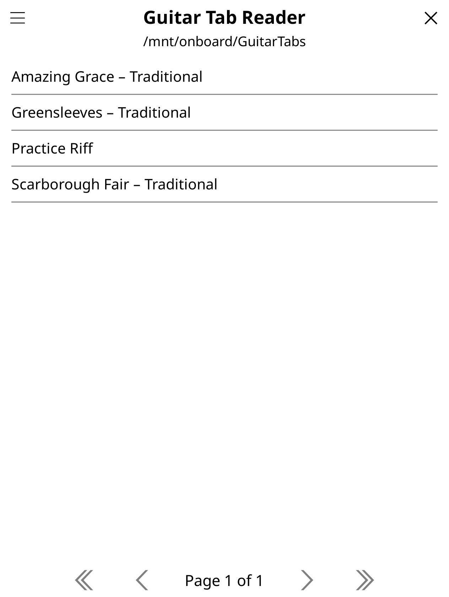
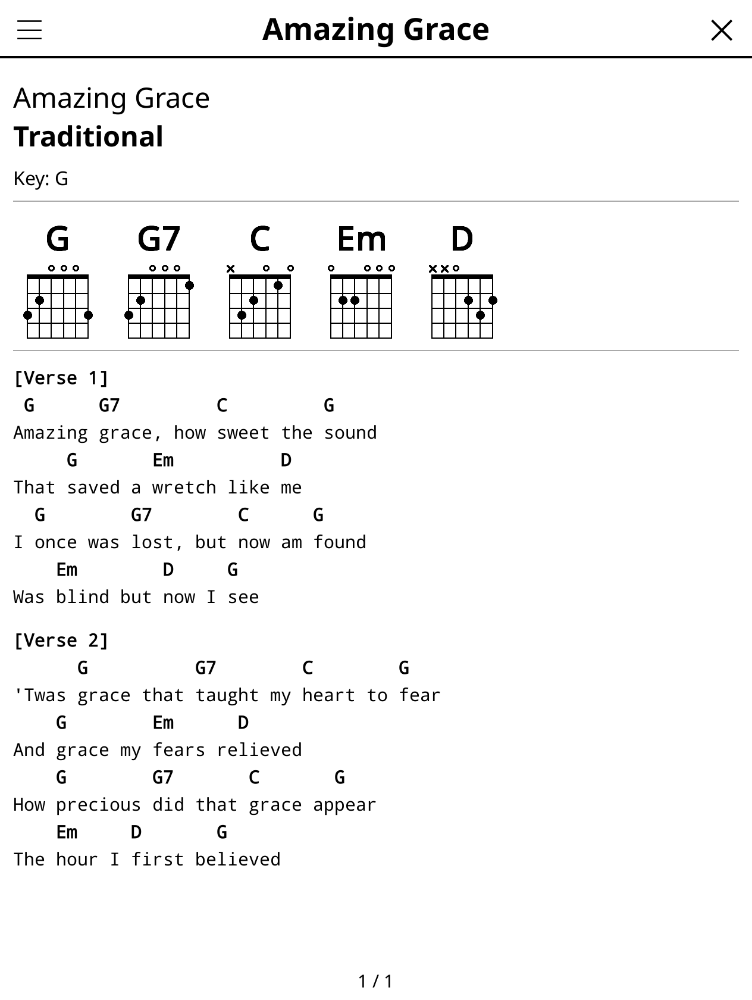
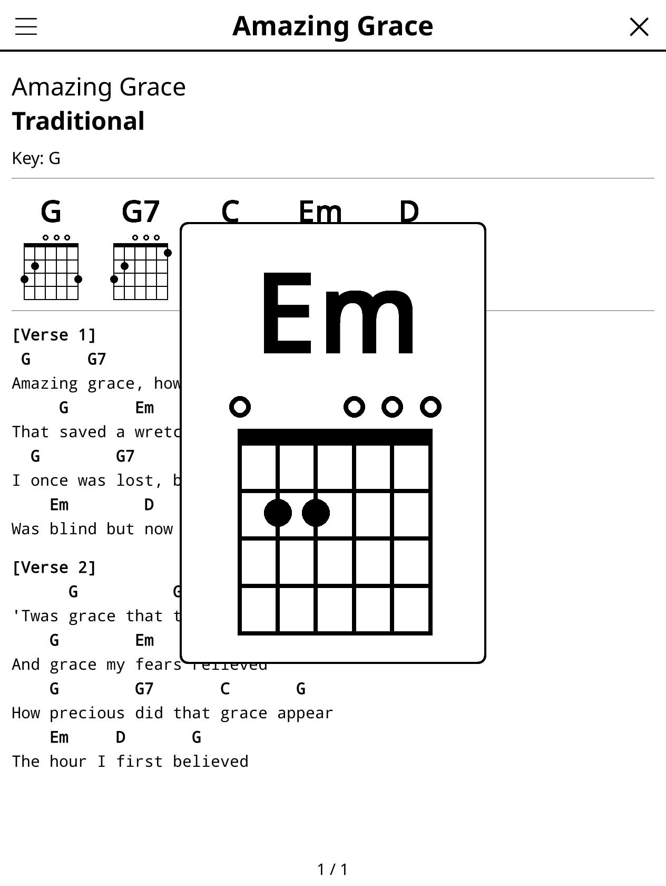
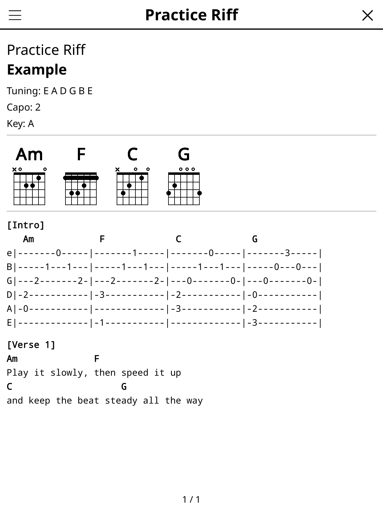
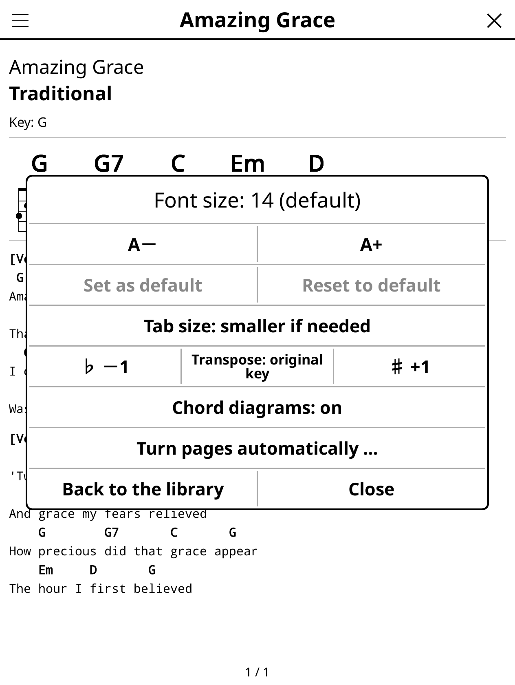
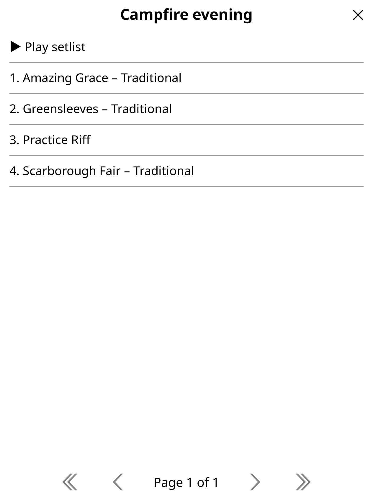
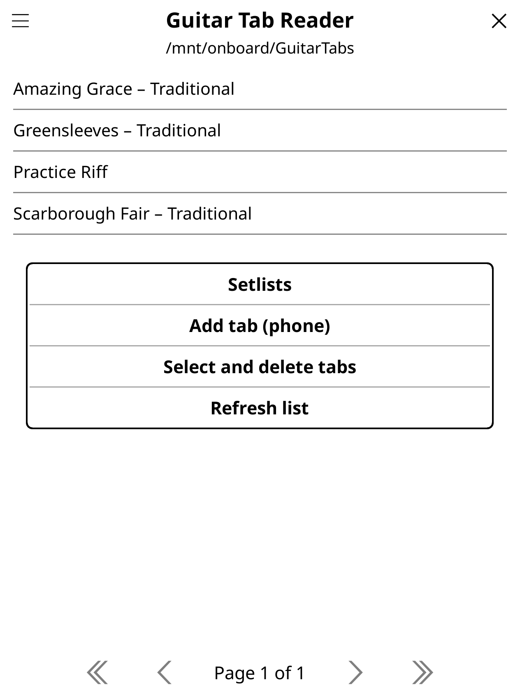
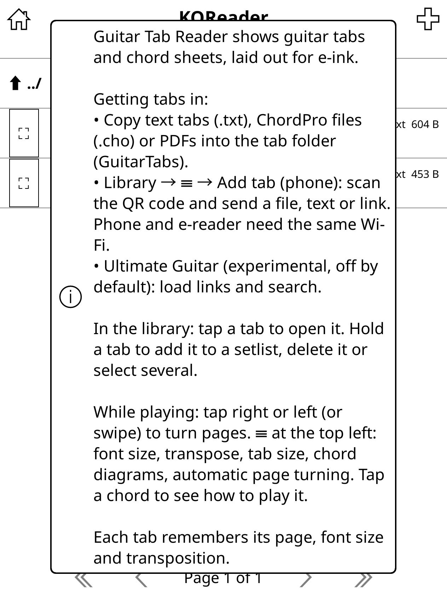

# Guitar Tab Reader für KOReader

*English: [README.md](README.md)*

<!-- byline -->
Ein Plugin von **Akrota und Claude**.

<!-- lang-note -->
*Funktioniert auf **Deutsch und Englisch**: Menüs und Texte richten sich nach der KOReader-Sprache.*

Gitarren-Tabs und Chords auf dem E-Reader, aufbereitet für E-Ink. Den E-Reader auf den Notenständer stellen: großer, ruhiger Bildschirm, kein Handy nötig.

> **Stand: 0.7.0.** Alle automatischen Tests laufen in KOReader unter macOS und Linux (in der Größe eines Kobo Libra Colour). Auf einem Kobo Libra Colour getestet, auch die Ultimate-Guitar-Suche.

## Bildschirmfotos

*Die Bildschirmfotos zeigen die englische Oberfläche; in einem deutschen KOReader sind die Texte deutsch.*

<table>
<tr><td align="center" valign="top" width="33%"> Bibliothek</td><td align="center" valign="top" width="33%"> ChordPro-Tab mit Reihe von Akkorddiagrammen</td><td align="center" valign="top" width="33%"> Angetippter Akkord als großes Diagramm</td></tr>
<tr><td align="center" valign="top" width="33%"> ASCII-Tab mit Akkorden über dem Text</td><td align="center" valign="top" width="33%"> Ansichtsmenü: Schriftgröße, Transponieren, Tab-Größe, Akkorddiagramme, automatisches Umblättern</td><td align="center" valign="top" width="33%"> Eine Setliste</td></tr>
<tr><td align="center" valign="top" width="33%"> Bibliotheksmenü: Setlisten, Tab vom Handy, Auswählen und Löschen</td><td align="center" valign="top" width="33%"> Hilfetext</td></tr>
</table>

## Was es kann

- **Bibliothek:** alle Tabs im Tab-Ordner (`GuitarTabs`) und seinen Unterordnern, zuletzt gespielte zuerst. Neue Dateien erscheinen automatisch.
- **Formate:** Text-Tabs (`.txt`, `.tab`), ChordPro (`.cho`, `.chopro`, `.chordpro`, `.pro`, `.crd`), das Ultimate-Guitar-Format (`[ch]`, `[tab]`) und **PDFs aus der Ultimate-Guitar-App**: Der Text wird mit seinen Positionen gelesen und neu gesetzt. Andere PDFs erscheinen als einfacher Text.
- **Darstellung wie ein gedrucktes Tab-Blatt:** Kopf mit Titel, Interpret, Stimmung, Capo und Tonart, oben die Chord-Diagramme, darunter der Song in Festbreitenschrift mit fetten Chords über der richtigen Silbe. Tabs werden nie mitten in der Zeile umgebrochen, zu breite Tabs werden an Taktstrichen geteilt.
- **Lesen:** Blättern per Tippen, Wischen oder Blättertasten. Schriftgröße pro Tab, „Als Standard setzen“ und „Auf Standard zurücksetzen“, drei Tab-Größen (nur verkleinern / an Breite anpassen / wie Text).
- **Chords:** Einen Chord antippen zeigt sein Griffbild. Transponieren ♭−1 / ♯+1 (Chords, Tonart und Diagramme ändern sich, Tab-Zahlen nicht).
- **Automatisch blättern** (Sekunden pro Seite).
- **Setlisten:** beliebig viele. Tab gedrückt halten → „Zu einer Setlist hinzufügen“. Zu finden unter Bibliothek ☰ → „Setlisten“. Spielt man aus einer Setlist, steht auf der letzten Seite der nächste Song, und Weiterblättern öffnet ihn.
- **Tabs löschen:** Tab gedrückt halten → „Löschen“, oder „Mehrere auswählen …“, Tabs abhaken und zusammen löschen. Vorher kommt immer eine Rückfrage.
- **Vom Handy, ohne Computer:** Bibliothek ☰ → „Tab hinzufügen (Handy)“ zeigt einen QR-Code. Auf der Seite schickst du Dateien, eingefügten Text oder einen Link (selbes WLAN). PDFs aus der Ultimate-Guitar-App vorher in „Dateien“ sichern und dann hochladen. Die Seite ist durch ein geheimes Kürzel in der Adresse geschützt und läuft nur bei offener Bibliothek.
- **Ultimate-Guitar-Modul (experimentell, standardmäßig aus):** Tabs aus Links laden und Ultimate Guitar am E-Reader durchsuchen (nur Gitarren-Chords und -Tabs, keine Pro- oder offiziellen Tabs). Siehe Hinweis unten.
- **Gesten / ZenOS:** Aktionen „Bibliothek öffnen“, „Setlisten“ und „Ultimate Guitar durchsuchen“.
- **„Wie funktioniert das?“**: kurze Anleitung als letzter Eintrag unter Werkzeuge → Guitar Tab Reader.
- Deutsch und Englisch.

## Installation

1. `guitartabreader.koplugin.zip` bei den Releases herunterladen und in den `plugins`-Ordner von KOReader entpacken (Kobo: `.adds/koreader/plugins`).
2. KOReader neu starten.
3. Tabs in den Ordner `GuitarTabs` im Hauptverzeichnis des Geräts legen (er wird angelegt, falls er fehlt, und lässt sich in den Einstellungen ändern).
4. Öffnen über **Werkzeuge → Guitar Tab Reader → Bibliothek öffnen** oder per Geste.

## Zum Ultimate-Guitar-Modul

Das Modul ist aus, bis du es einschaltest (Werkzeuge → Guitar Tab Reader → Ultimate Guitar (experimentell)). Es liest öffentliche Seiten einzeln und mit Pause, unter KOReaders eigenem Namen: keine Anmeldung, keine Pro- oder offiziellen Tabs, kein Umgehen von Sperren. Blockiert Ultimate Guitar eine Anfrage, hört das Modul auf und meldet es.

Es bleibt eine Grauzone: Automatischer Zugriff entspricht nicht ganz den Nutzungsbedingungen von Ultimate Guitar. Nutzung auf eigene Gefahr, Ultimate Guitar kann den Zugang jederzeit sperren. Dieses Projekt hat nichts mit Ultimate Guitar zu tun.

## Noch nicht drin

- Strumming Pattern
- Bass und Ukulele
- Guitar-Pro-Dateien

## Tests

In `tests/` liegen Unit-Tests (`luajit tests/unit_*.lua`) und KOReader-Testskripte (`tests/2-gtr-*.lua`, laufen als KOReader-Patches). `tests/run-tests.sh` startet alles mit der KOReader-Version für macOS. Die Beispiel-Tabs und Ultimate-Guitar-Seiten in `tests/` sind erfunden. Für die PDF-Tests braucht man ein PDF aus der Ultimate-Guitar-App in `test tabs/`, das nicht dabei ist.

## Wer das gemacht hat

Den Code hat vollständig **Claude** geschrieben, eine KI von Anthropic (in Claude Code). Der Inhaber dieses Projekts hatte die Idee, hat das Plugin auf einem Kobo getestet und Rückmeldungen gegeben, aber keinen Code geschrieben.

Keine Gewährleistung und kein garantierter Support. Fehlermeldungen gern als [Issue](../../issues). Bitte `crash.log` aus dem KOReader-Ordner anhängen.

## Weitere Plugins von Akrota und Claude

- [Comic Display](https://github.com/Akrota/koreader-comic-display): Refresh gegen Ghosting, dunkle Ränder und Uhr für Comics
- [Levels / Tonwerte](https://github.com/Akrota/koreader-comic-levels): Tonwertkurve für Comics
- [Comic Panel Zoom](https://github.com/Akrota/koreader-comic-panel-zoom): Panel-für-Panel-Ansicht (Fork von JorgeTheFox)
- [Comic Dual Page](https://github.com/Akrota/koreader-comic-dual-page): Doppelseiten mit Erkennung (Fork von KORComic)
- [CBZ Converter](https://github.com/Akrota/koreader-cbz-converter): Comics, PDF und EPUB auf dem Gerät in CBZ umwandeln
- [Folder to series](https://github.com/Akrota/koreader-folder-to-series): Comic-Ordner zu Reihen mit Bandnummern
- [Drive Library](https://github.com/Akrota/koreader-drive-library): Google Drive als Cloud-Bibliothek
- [Story Recall](https://github.com/Akrota/koreader-story-recall): Spoilerfreier KI-Rückblick auf Bücher
- [Wi-Fi while charging](https://github.com/Akrota/koreader-wifi-while-charging): WLAN anlassen, solange das Gerät lädt
- [Zen page browser gesture](https://github.com/Akrota/koreader-zen-page-browser-gesture): Geste für den ZenOS-Seitenbrowser

## Lizenz

MIT, siehe [LICENSE](LICENSE).
