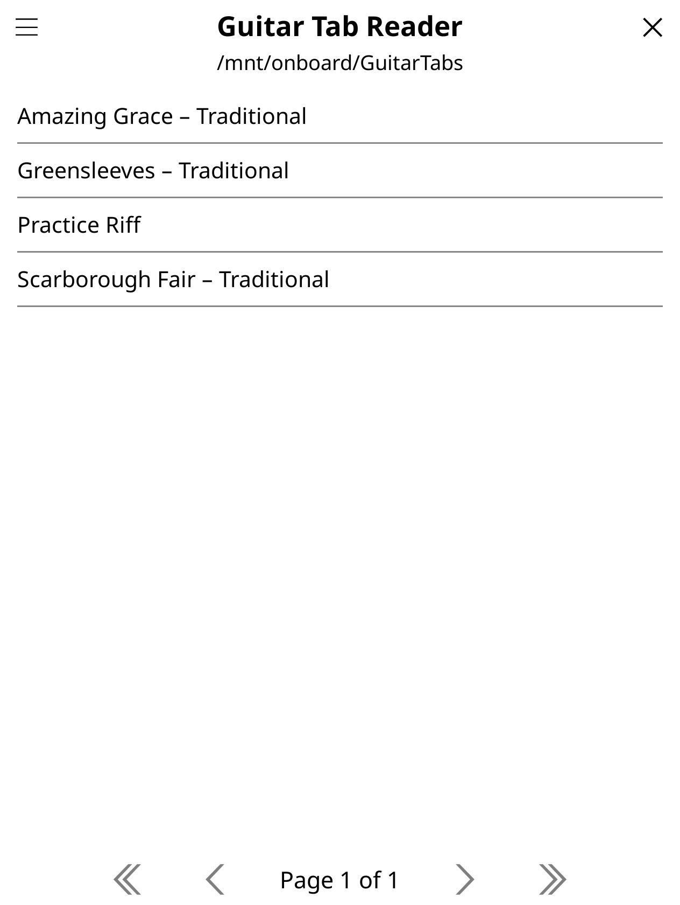
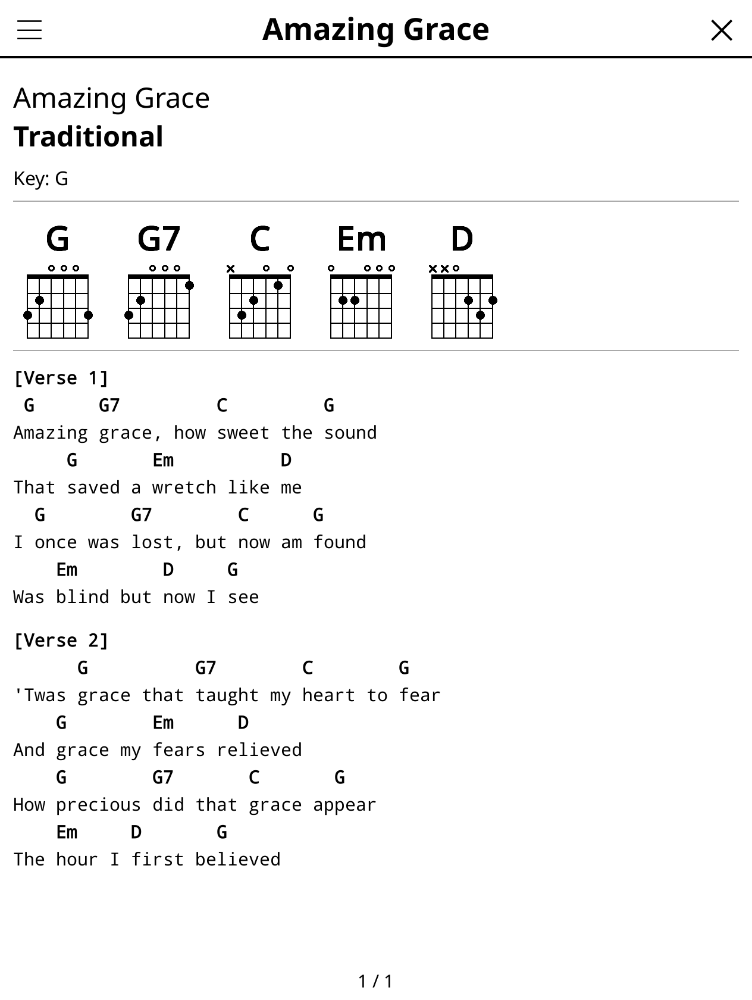
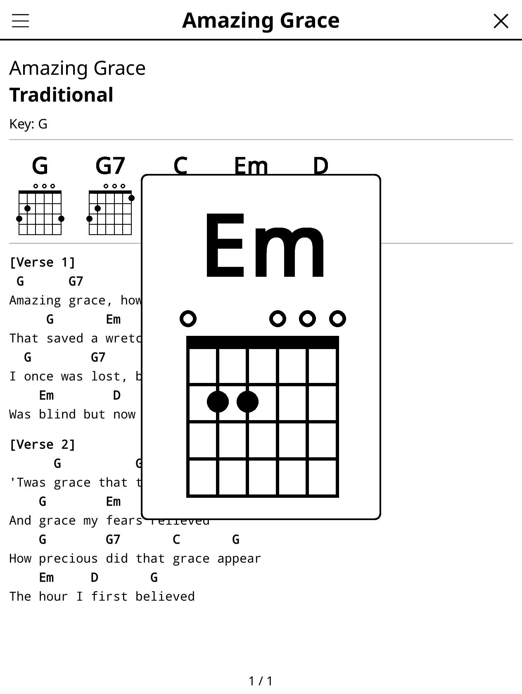
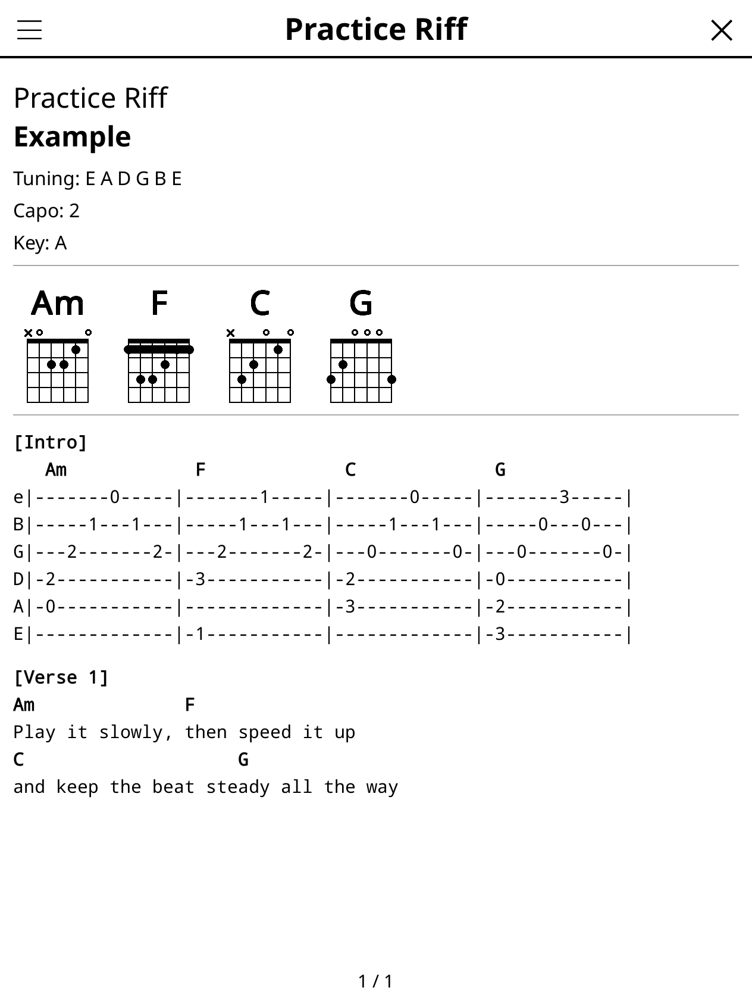
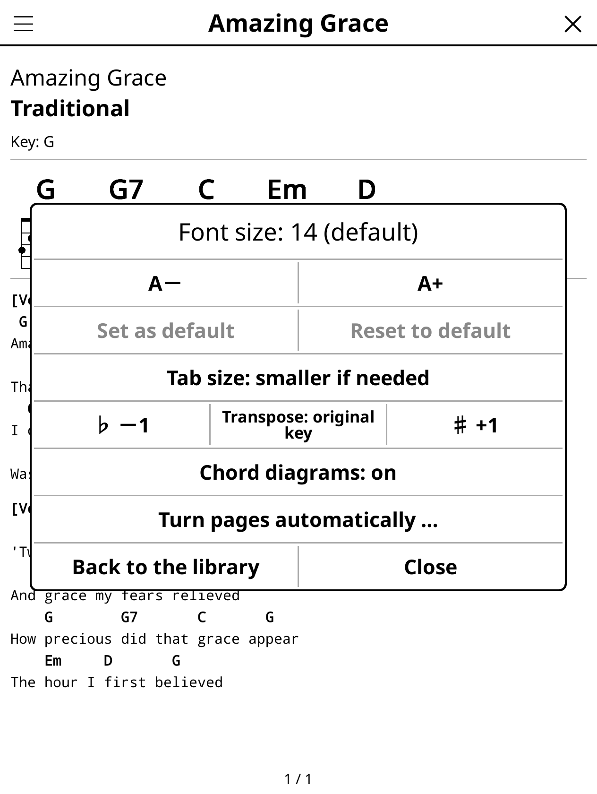
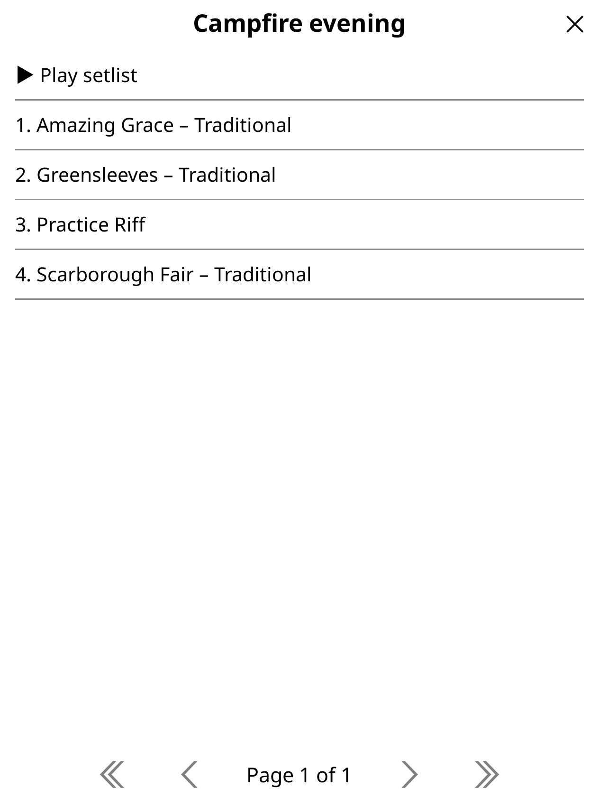
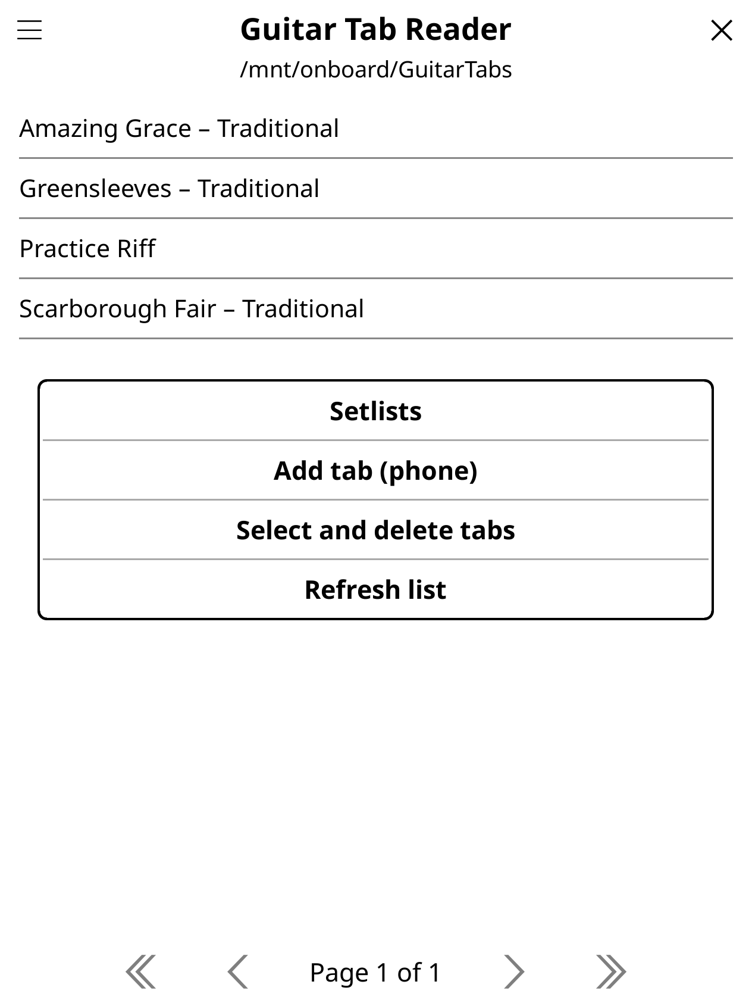
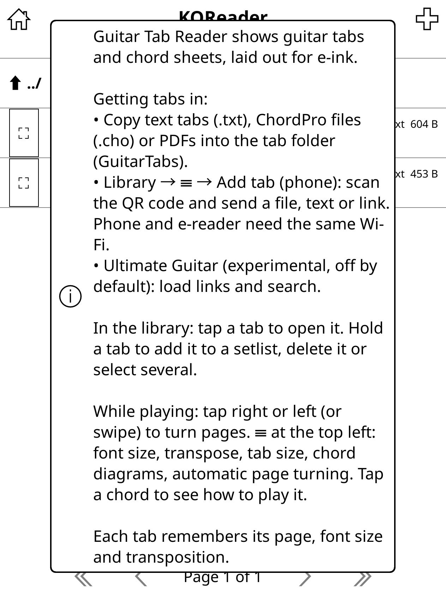

# Guitar Tab Reader for KOReader

*Deutsch: [README.de.md](README.de.md)*

<!-- byline -->
A plugin by **Akrota and Claude**.

<!-- lang-note -->
*Works in **English and German**: menus and texts follow KOReader's language. A German description is at the bottom of this page.*

Guitar tabs and chord sheets on your e-reader, laid out for e-ink. Put the e-reader on the music stand: a large, calm screen, no phone needed.

> **Status: 0.7.0.** All automated tests pass in KOReader on macOS and Linux (at the size of a Kobo Libra Colour). Tested on a Kobo Libra Colour, including the Ultimate Guitar search.

## Screenshots

*The screenshots show the English interface; in a German KOReader the texts are German.*

<table>
<tr><td align="center" valign="top" width="33%"> Library list</td><td align="center" valign="top" width="33%"> ChordPro tab with chord diagram row</td><td align="center" valign="top" width="33%"> A tapped chord as a large diagram</td></tr>
<tr><td align="center" valign="top" width="33%"> ASCII tab with chords above the lyrics</td><td align="center" valign="top" width="33%"> Viewer menu: font size, transpose, tab size, chord diagrams, auto page turn</td><td align="center" valign="top" width="33%"> A setlist</td></tr>
<tr><td align="center" valign="top" width="33%"> Library menu: setlists, add tab from phone, select and delete</td><td align="center" valign="top" width="33%"> Help text</td></tr>
</table>

## Features

- **Library:** every tab in the tab folder (`GuitarTabs`) and its subfolders, recently played first. New files show up automatically.
- **Formats:** text tabs (`.txt`, `.tab`), ChordPro (`.cho`, `.chopro`, `.chordpro`, `.pro`, `.crd`), the Ultimate Guitar markup (`[ch]`, `[tab]`) and **PDFs saved from the Ultimate Guitar app**: the text is read with its positions and laid out again. Other PDFs are shown as plain text.
- **Layout like a printed tab sheet:** a header with title, artist, tuning, capo and key, chord diagrams at the top, the song in a monospaced font with bold chords above the right syllable. Tabs are never wrapped in the middle of a line; wide tabs are split at bar lines.
- **Reading:** tap or swipe to turn pages, page keys work too. Font size per tab, "set as default" and "reset to default", three tab sizes (only shrink / fit the width / like the text).
- **Chords:** tap a chord to see its fingering. Transpose ♭−1 / ♯+1 (chords, key and diagrams change, tab numbers don't).
- **Automatic page turning** (seconds per page).
- **Setlists:** as many as you like. Hold a tab → "Add to setlist". Open them under library ☰ → "Setlists". Played from a setlist, the last page shows the next song, and turning the page opens it.
- **Deleting tabs:** hold a tab → "Delete", or "Select several…" to check tabs and delete them together. Always asks first.
- **From your phone, without a computer:** library ☰ → "Add tab (phone)" shows a QR code. The page lets you send files, pasted text or a link (same Wi-Fi). For PDFs from the Ultimate Guitar app, save them to Files first and then upload them. The page is protected by a secret key in its address and only runs while the library is open.
- **Ultimate Guitar module (experimental, off by default):** load tabs from links and search Ultimate Guitar on the e-reader (guitar chords and tabs only, no Pro or official tabs). See the note below.
- **Gestures / ZenOS:** actions "open library", "setlists" and "search Ultimate Guitar".
- **"How does it work?"**: a short guide as the last entry under Tools → Guitar Tab Reader.
- English and German.

## Installation

1. Download `guitartabreader.koplugin.zip` from the releases and unzip it into KOReader's `plugins` folder (Kobo: `.adds/koreader/plugins`).
2. Restart KOReader.
3. Put tabs into the folder `GuitarTabs` in the main folder of the device (it is created if missing; you can choose another one in the settings).
4. Open it via **Tools → Guitar Tab Reader → Open library**, or with a gesture.

## About the Ultimate Guitar module

The module is off until you switch it on (Tools → Guitar Tab Reader → Ultimate Guitar (experimental)). It reads public pages one at a time, with a pause, under KOReader's own name: no login, no Pro or official tabs, nothing that gets around a block. If Ultimate Guitar blocks a request, the module stops and says so.

It is still a grey area: automated access does not fully match Ultimate Guitar's terms of use. Use it at your own risk; Ultimate Guitar may block access at any time. This project is not affiliated with Ultimate Guitar.

## Not yet included

- Strumming patterns
- Bass and ukulele
- Guitar Pro files

## Tests

`tests/` holds unit tests (`luajit tests/unit_*.lua`) and KOReader test scripts (`tests/2-gtr-*.lua`, run as KOReader patches). `tests/run-tests.sh` runs everything with the KOReader build for macOS. The sample tabs and Ultimate Guitar pages in `tests/` are made up. The PDF tests need a PDF saved from the Ultimate Guitar app in `test tabs/`, which is not included.

## Who made this

The code was written entirely by **Claude**, an AI by Anthropic (in Claude Code). The owner of this repository came up with the idea, tested the plugin on a Kobo and gave feedback, but did not write the code.

There is no warranty and no guaranteed support. Bug reports are welcome as [issues](../../issues). Please attach `crash.log` from the KOReader folder.

## More plugins by Akrota and Claude

- [Comic Display](https://github.com/Akrota/koreader-comic-display): Refresh against ghosting, dark borders and a clock for comics
- [Levels / Tonwerte](https://github.com/Akrota/koreader-comic-levels): Tone curve for comics
- [Comic Panel Zoom](https://github.com/Akrota/koreader-comic-panel-zoom): Panel-by-panel view (fork of JorgeTheFox's plugin)
- [Comic Dual Page](https://github.com/Akrota/koreader-comic-dual-page): Double pages with detection (fork of KORComic)
- [CBZ Converter](https://github.com/Akrota/koreader-cbz-converter): Convert comics, PDF and EPUB to CBZ on the device
- [Folder to series](https://github.com/Akrota/koreader-folder-to-series): Comic folders to series with volume numbers
- [Drive Library](https://github.com/Akrota/koreader-drive-library): Google Drive as a cloud library
- [Story Recall](https://github.com/Akrota/koreader-story-recall): Spoiler-free AI recap for books
- [Wi-Fi while charging](https://github.com/Akrota/koreader-wifi-while-charging): Keep Wi-Fi on while charging
- [Zen page browser gesture](https://github.com/Akrota/koreader-zen-page-browser-gesture): Gesture for the ZenOS page browser

## License

MIT, see [LICENSE](LICENSE).

---

## Deutsch (Kurzbeschreibung)

Gitarren-Tabs und Chords auf dem E-Reader, aufbereitet für E-Ink. Den E-Reader auf den Notenständer stellen: großer, ruhiger Bildschirm, kein Handy nötig.

> **Stand: 0.7.0.** Alle automatischen Tests laufen in KOReader unter macOS und Linux (in der Größe eines Kobo Libra Colour). Auf einem Kobo Libra Colour getestet, auch die Ultimate-Guitar-Suche.

### Was es kann

- **Bibliothek:** alle Tabs im Tab-Ordner (`GuitarTabs`) und seinen Unterordnern, zuletzt gespielte zuerst. Neue Dateien erscheinen automatisch.
- **Formate:** Text-Tabs (`.txt`, `.tab`), ChordPro (`.cho`, `.chopro`, `.chordpro`, `.pro`, `.crd`), das Ultimate-Guitar-Format (`[ch]`, `[tab]`) und **PDFs aus der Ultimate-Guitar-App**: Der Text wird mit seinen Positionen gelesen und neu gesetzt. Andere PDFs erscheinen als einfacher Text.
- **Darstellung wie ein gedrucktes Tab-Blatt:** Kopf mit Titel, Interpret, Stimmung, Capo und Tonart, oben die Chord-Diagramme, darunter der Song in Festbreitenschrift mit fetten Chords über der richtigen Silbe. Tabs werden nie mitten in der Zeile umgebrochen, zu breite Tabs werden an Taktstrichen geteilt.
- **Lesen:** Blättern per Tippen, Wischen oder Blättertasten. Schriftgröße pro Tab, „Als Standard setzen“ und „Auf Standard zurücksetzen“, drei Tab-Größen (nur verkleinern / an Breite anpassen / wie Text).
- **Chords:** Einen Chord antippen zeigt sein Griffbild. Transponieren ♭−1 / ♯+1 (Chords, Tonart und Diagramme ändern sich, Tab-Zahlen nicht).
- **Automatisch blättern** (Sekunden pro Seite).
- **Setlisten:** beliebig viele. Tab gedrückt halten → „Zu einer Setlist hinzufügen“. Zu finden unter Bibliothek ☰ → „Setlisten“. Spielt man aus einer Setlist, steht auf der letzten Seite der nächste Song, und Weiterblättern öffnet ihn.
- **Tabs löschen:** Tab gedrückt halten → „Löschen“, oder „Mehrere auswählen …“, Tabs abhaken und zusammen löschen. Vorher kommt immer eine Rückfrage.

Die ausführliche deutsche Anleitung steht in der [README.de.md](README.de.md).
